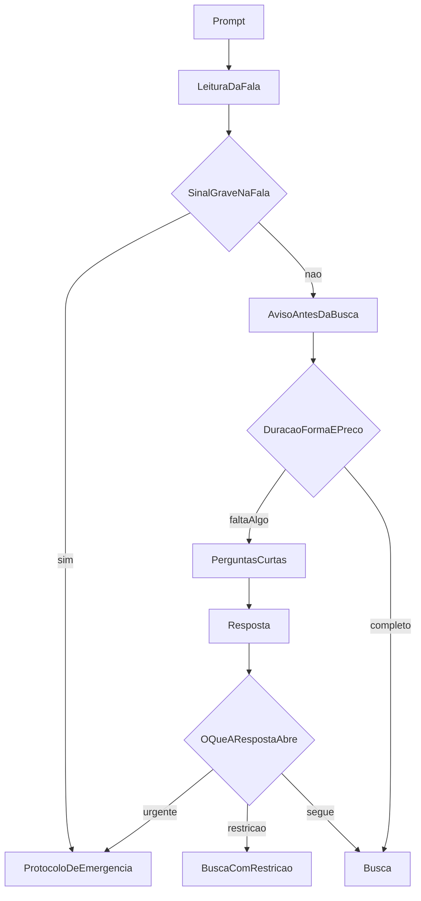
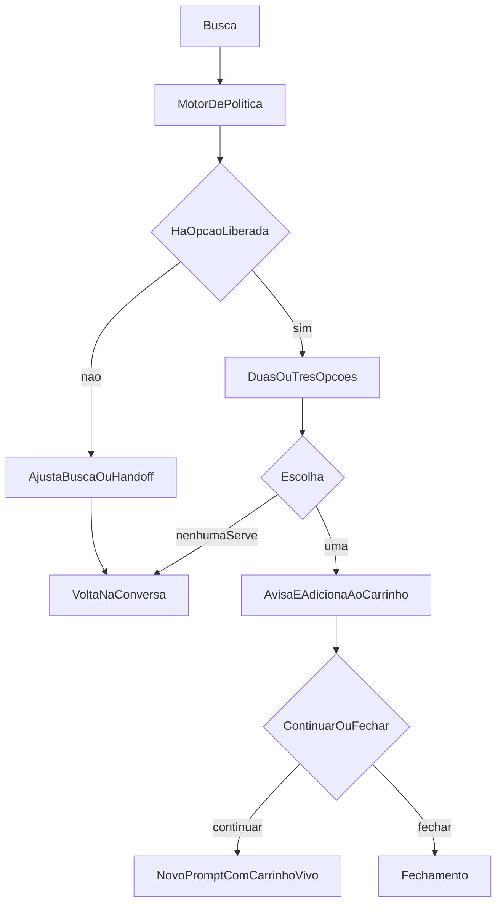
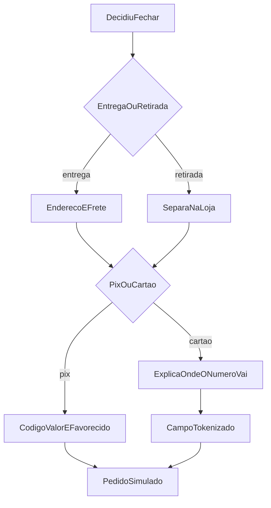
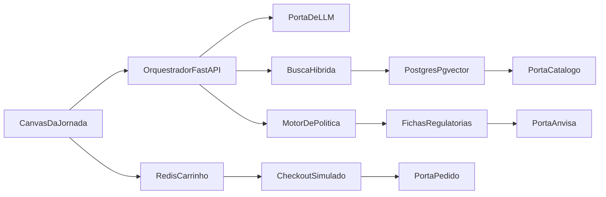

# IA Commerce — compilado de produto e arquitetura

Documento fechado em 14 de outubro de 2026. Junta o desenho de produto (concierge, personas, guardrails, cronograma) com o levantamento do catálogo público e das portas de integração. O repositório hoje é um esqueleto FastAPI (`main.py`, `Dockerfile`, `requirements.txt`). Este arquivo é o ponto de partida. O protótipo da jornada vem na fase seguinte.

O repositório permanece privado.

## Harmonização

- **Produto.** O Concierge de Saúde e Bem-Estar conversa, pergunta o que falta e leva a pessoa até retirada ou entrega. A unidade da experiência é a jornada: necessidade, opções, restrição, carrinho e fechamento. O histórico existe para refinar. A tela principal é o estado da compra.
- **Segurança.** Três guardrails de conversa (contraindicação, alerta de receita, triagem de urgência) operam junto com as classes de risco medidas no catálogo. Urgência e classe correm antes da busca. A classe decide o que pode ir ao card e ao carrinho.
- **RAG.** Recupera evidência: descrição do produto, ficha regulatória, restrição curada. Não autoriza venda. O CSV aberto da Anvisa não traz contraindicação estruturada, então a bula PDF de todo o catálogo fica fora desta fase.
- **Catálogo.** Índice real ingerido da loja pública, em PostgreSQL. Complemento sintético só onde o dado público falta: tarja, contraindicação, EAN inválido.
- **Orquestração.** Agente em FastAPI com saída estruturada. LangChain ou LlamaIndex entram só se reduzirem código. O guardrail fica no motor de política, fora do prompt.
- **Linguagem clínica.** A oferta são opções compatíveis com a intenção. Forma, quantidade e intervalo de tomada só entram no card quando estão escritos na ficha da embalagem, com a frase de que aquilo é texto de caixa. A IA não cria posologia, não diagnostica e não substitui médico nem farmacêutico.
- **Fluxo de telas.** O aviso de governança aparece antes de qualquer busca. A conversa seguinte afia a prateleira: tempo da queixa, forma (comprimido, pomada ou cuidado leve) e teto de preço quando a pessoa não disse. A oferta traz duas ou três opções. O fechamento pergunta se continua comprando, se retira ou entrega, e se paga no Pix ou no cartão.

## 1. Produto

### Problema

No e-commerce farmacêutico o consumidor atravessa menu, filtro, bula longa e carrinho item a item, sem contexto. A jornada nova começa num prompt e termina numa compra, com as decisões visíveis.

### Concierge

O agente orquestrador conduz a compra. Antes de buscar, dá o aviso de balcão e pergunta só o que afia a prateleira: tempo da queixa, forma e teto de preço. A oferta sai em dois ou três cards, com o texto da caixa. A pessoa escolhe, o item entra no carrinho, e ela segue comprando ou fecha com retirada ou entrega, Pix ou cartão tokenizado.

### Personas

- **Paciente sintomático.** Quer alívio de sintoma comum com segurança. A jornada de demonstração é a da Marina: dor perto da nuca, teto de R$ 100, comprimido, retirada e Pix. Gripe leve com hipertensão é o desvio de contraindicação.
- **Consumidor de bem-estar.** Quer vitamina, dermocosmético ou reposição de rotina. A conversa personaliza sem formulário (marca própria, genérico, orçamento) e o tom clínico sai de cena, porque a classe é `bem_estar` ou `bem_geral`.

Faixa etária, gestação e cuidador comprando para outra pessoa entram como restrição dentro dessas duas personas.

### Diferenciação

O concierge monta um estado de compra e só oferece o que a política liberou. Fluidez, relevância, cuidado com saúde, personalização sem formulário e integração plausível com a VTEX são os critérios que a jornada precisa mostrar.

## 2. Fluxo de telas

A demonstração principal usa a Marina, com dor perto da nuca e teto de R$ 100. A voz do balcão é a Lia. Ela fala como gente de farmácia: uma observação, uma pergunta útil, uma prateleira curta.

Telas, nesta ordem: prompt, aviso com perguntas, cards, carrinho, entrega ou retirada, pagamento, confirmação. Urgência, recusa das opções e pedido de controlado saem desse corredor.

As figuras para colar na conversa estão em:

- [Abertura](fluxogramas/01-abertura.png)
- [Oferta](fluxogramas/02-oferta.png)
- [Fechamento](fluxogramas/03-fechamento.png)

### Abertura — aviso antes da busca

Dor de nuca comum não dispara emergência. O primeiro retorno é sempre o aviso, e a busca só corre depois das respostas que faltam. Se a fala inicial já for grave (dor no peito, falta de ar), o aviso cabe numa frase e o caminho vai para o protocolo, sem card.

O aviso cobre quatro pontos: isto é sugestão de compra; o acompanhamento médico é o caminho certo; há medicamento de balcão sem receita; a Lia não substitui o médico.

Perguntas, no máximo duas por vez, só o que a fala ainda não trouxe:

- Há quanto tempo está essa dor?
- Prefere comprimido, pomada, ou um cuidado mais leve, como chá ou óleo de lavanda?
- Se o preço não veio na fala, qual o teto?

Não há questionário. Uma terceira pergunta só aparece se a resposta abrir risco: criança, gestação, "a pior da minha vida", desmaio, rigidez com febre.

### Oferta — duas ou três caixas

Cada card usa fato do índice, dentro do teto de preço: para que a caixa se apresenta, se é comprimido ou outra forma, quantidade, peso ou concentração, intervalo de tomada quando a embalagem indexada tiver esse texto, preço e estoque. A Lia diz que aquilo está na caixa. Se o intervalo não estiver na ficha, o card não inventa.

### Fechamento — entrega e pagamento

Continuar comprando volta ao prompt com o carrinho preservado. Fechar pergunta primeiro retirada ou entrega. Entrega pede o endereço e mostra o frete antes do pagamento. Retirada só separa o item.

Pix mostra código copia e cola, valor, favorecido e validade, com selo de simulação. Cartão pede número, validade e código num campo do provedor de pagamento. A API recebe token, bandeira e final. O número não entra em log, banco nem prompt do modelo. A Lia explica isso antes de pedir os dados. No protótipo o token é falso e nenhuma cobrança acontece. O pedido nasce `pending_integration`.

### Caminhos ligados

- **Marina, comprimido, retirada, Pix.** Aviso, duas perguntas, três cards, um item, retirada, Pix.
- **Cuidado leve.** Ela prefere óleo ou chá. A busca muda para `bem_estar`, sem texto de posologia.
- **Sem preço na fala.** A Lia pergunta o teto antes de buscar.
- **Nenhuma opção serve.** Ela pede pomada. A busca refaz com a forma nova, de novo com dois ou três cards.
- **Continuar comprando.** O carrinho fica. Uma segunda fala recomeça no aviso curto, sem repetir o texto inteiro.
- **Entrega e cartão.** Endereço, frete, explicação do token, confirmação.
- **Sinal grave na resposta.** Protocolo de emergência, carrinho comercial vazio.
- **Pede controlado pelo nome.** Sem card e sem checkout. Handoff para o balcão da loja.

## 3. Diálogos

Os preços e os intervalos abaixo são de roteiro. Na aplicação, cada um só aparece se estiver na ficha indexada.

### Caminho principal

Marina: Estou com uma dor de cabeça localizada perto da nuca e gostaria de comprar um remédio que custe até 100 reais.

Lia: Antes de eu olhar qualquer caixa, deixa eu te situar. O que eu separar é sugestão de compra, coisa de balcão. Tem remédio que sai sem receita, e mesmo assim o certo é ter um médico junto se essa dor insistir, piorar ou voltar sempre. Eu não substituo essa consulta.

Lia: O teto de 100 reais eu já anotei. Me diz duas coisas para eu não te trazer a prateleira inteira. Faz quanto tempo que essa dor está aí, perto da nuca? E você quer comprimido, algo de passar, ou um cuidado mais leve, tipo um chá ou um óleo de lavanda?

Marina: Desde ontem à noite. Quero comprimido.

Lia: Separei três, todos comprimido e abaixo de 100. O que eu ler agora é o que está escrito na caixa, não uma receita minha.

Lia: A primeira é dipirona sódica 1 g, caixa com 10 comprimidos, para dor. A embalagem traz o intervalo para adulto. Sai a R$ 12. A segunda é paracetamol 750 mg, 20 comprimidos, outra opção de dor, sem ser anti-inflamatório, R$ 18. A terceira é ibuprofeno 400 mg, 10 comprimidos, anti-inflamatório de balcão, R$ 22. Esse eu deixo por último: se você tiver estômago sensível, estiver grávida ou já tomar outro remédio todo dia, a gente troca.

Marina: Pode ser a dipirona.

Lia: Coloquei a dipirona no carrinho, R$ 12. Quer olhar mais alguma coisa ou fechamos?

Marina: Pode fechar.

Lia: Prefere retirar na loja ou quer que eu entregue? Se for entrega, me passa o endereço que eu calculo o frete.

Marina: Retiro.

Lia: Fica separado para retirada. Pagamento no Pix ou no cartão? No Pix eu te mostro o código e o valor. No cartão, o número vai para o pagamento e não fica comigo.

Marina: Pix.

Lia: R$ 12. O código copia e cola está na tela, em nome da farmácia, válido por 30 minutos. Quando cair, o pedido fica pronto para retirar. Nesta demonstração a cobrança é simulada, e a tela diz isso com todas as letras.

### Cuidado leve

Marina: Prefiro não tomar comprimido. Tem um óleo de lavanda ou um chá?

Lia: Tem. Deixo o remédio de lado e olho cuidado leve, ainda dentro dos 100 reais. Sem intervalo de tomada, porque isso não é medicamento.

### Sem preço

Marina: Estou com a nuca doendo desde ontem.

Lia: O aviso é o mesmo: sugestão de balcão, médico se insistir, eu não substituo consulta. Você não me falou até quanto quer gastar. Me diz um teto, e se prefere comprimido, pomada ou algo mais leve.

### Nenhuma serve

Marina: Essas três não. A nuca está dura, quero passar alguma coisa.

Lia: Então tiro o comprimido do caminho. Olho pomada e cuidado local, no mesmo teto de 100.

### Continuar comprando

Marina: Antes de fechar, vê um óleo de lavanda também.

Lia: A dipirona continua no carrinho. Vou olhar só cuidado leve, para não misturar com outra caixa de remédio.

### Entrega e cartão

Marina: Entrega no meu apartamento, e pago no cartão.

Lia: Me passa rua, número, bairro e CEP que eu fecho o frete antes de cobrar. O frete entrou, R$ 9, total R$ 21. O número do cartão você digita num campo do pagamento, não no meu. Eu não vejo o número inteiro, não guardo e não mando isso para a conversa. Volta para mim só a bandeira e os quatro últimos dígitos. Pode digitar quando a tela abrir. Nada será cobrado de verdade nesta demonstração.

### Sinal grave

Marina: Na verdade começou de repente, a pior dor da minha vida, com enjoo e luzes na vista.

Lia: Isso eu não resolvo com comprimido. Para aqui. Dor súbita, muito forte, com enjoo e alteração visual pede pronto-socorro, não farmácia. Não vou te mostrar produto. Se tiver alguém por perto, pede para te acompanhar.

### Controlado

Marina: Na verdade me vê um Rivotril.

Lia: Esse eu não separo por aqui. Clonazepam é de controle especial, com receita e retirada no balcão da farmácia. O carrinho continua só com o que já era de venda livre. Posso te indicar a loja, sem colocar essa caixa.

## 4. Arquitetura

### Stack

- Experiência: Next.js (App Router), TypeScript, Tailwind. Canvas com composer, cards e barra de carrinho.
- API: o FastAPI atual, em Python 3.12. O Dockerfile está em 3.9 e sobe junto com a API. Pydantic v2 no contrato da jornada.
- Dados: PostgreSQL 16 com pgvector. Redis para jornada quente e carrinho.
- LLM: porta com saída estruturada, provedor trocável (Gemini ou OpenAI). Sem chave, a busca lexical e os templates ainda completam uma jornada.
- Embeddings: só para achar e explicar. A autorização de venda fica no motor de política.
- Carga: job Python na subida e sob demanda.
- Ambiente: Docker Compose com web, api, postgres e redis.
- Teste que trava o hackathon: pytest do motor de política.

### Contrato

O modelo devolve a intenção. A lista de SKUs sai da busca e da política.

- `POST /journeys` abre a jornada a partir do prompt.
- `POST /journeys/{id}/turns` refina intenção e texto.
- `GET /journeys/{id}` devolve o canvas: intenção, ofertas já filtradas, avisos, carrinho, handoffs, estado de urgência.
- `POST /journeys/{id}/cart/items` recusa SKU que a política não liberou.
- `POST /journeys/{id}/checkout` avança retirada ou entrega simuladas e grava o pedido.
- `POST /safety/evaluate` é interno. Urgência, classe e contraindicação passam por aqui, fora do modelo.

Intenção estruturada, estável entre provedores: tipo (`sintoma`, `produto_nomeado`, `reposicao`, `presente`, `servico`), público, duração, forma, teto de preço, restrições, princípios já em uso, e o que ficou ambíguo.

Personalização sai da conversa, com chip de confirmação ("guardar que você prefere genérico?"). Dado de saúde só persiste com consentimento, minimizado e com prazo curto. Sem ficha clínica e sem usar o prompt para treinar modelo.

### Portas

Cada porta tem adaptador de protótipo e adaptador futuro. Trocar o adaptador não muda orquestrador, política nem tela.

- **Catálogo.** Agora: search e árvore públicas da VTEX, índice local. Depois: Catalog API privada, preço e estoque por política comercial. A UI lê só o índice local.
- **Regulatório.** Agora: CSV Anvisa, Portaria SVS/MS 344/1998 e allowlist de MIPs, mais fichas curadas de contraindicação (hipertensão, diabetes, gestação, faixa etária, substância já citada). Depois: API Anvisa com credencial Gov.br e seções de bula de um subconjunto.
- **Pedido.** Agora: `orderForm` local, com Pix simulado e cartão tokenizado. Depois: Checkout API VTEX, frete e OMS. O número completo do cartão não passa pelo nosso backend: a tela fala com o provedor e a API só guarda token, bandeira e final.
- **Pessoa.** Agora: sessão anônima e perfil consentido. Depois: Master Data VTEX, mesma base legal.
- **Cuidado humano.** Agora: registro de handoff (farmacêutico, AME, manipulação, serviço, urgência). Depois: fila desses canais, inclusive Clinic Farma.

### Fora deste protótipo

Cobrança real, validação de receita, posologia inventada, diagnóstico, bula completa de todo o catálogo, estoque por loja e qualquer chamada que crie carrinho na loja de produção. O fluxo de Pix e de cartão existe na tela, sempre simulado e tokenizado.

## 5. Dados que sustentam o desenho

Consulta em 8 de outubro de 2026.

**Loja.** VTEX, conta `paguemenos`. Árvore em `GET https://www.paguemenos.com.br/api/catalog_system/pub/category/tree/2` (HTTP 200). Onze departamentos: Medicamentos e Saúde (100, com Sem Receita OTC 102, Dor e Febre 108, Sistema Nervoso Central 113, Psicotrópicos 684, Canabinóides 715), Higiene (200), Dermo (300), Mamães e Bebês (400), Vida Saudável (500), Conveniência (600), Pet (610), Manipulação (641), Serviços de Saúde (665).

**Produto.** `GET /api/catalog_system/pub/products/search/{termo}` responde 206, página em `_from` / `_to` e header `resources`. Campos estáveis: `productId`, nome, marca, categorias, descrição, EAN, preço, lista, disponibilidade, quantidade, e as especificações `Medicamento`, `Ame`, `MarcaPropria`, `NumeroRegistroMS`, `NomeSubstanciaPrincipioAtivo`.

Amostras: dipirona EMS com registro MS e princípio ativo; clonazepam (Rivotril) à venda na categoria Epilepsia, fora de Psicotrópicos; protetor e fralda sem princípio ativo (`Medicamento` ausente ou `False`, registro `ISENTO` na fralda).

**Lacunas.** Não há tarja nem contraindicação no payload. Registro e princípio faltam em parte dos medicamentos. Há EAN inválido. A categoria 684 não serve de trava. Preço é do seller padrão, sem CEP. Não há dump público do catálogo inteiro; a carga usa sementes por categoria e deduplica por `productId`. O filtro legado `fq=C:/100/102/` voltou vazio.

**Anvisa.** `https://dados.anvisa.gov.br/dados/DADOS_ABERTOS_MEDICAMENTOS.csv` (cerca de 46 MB, 07/10/2026, separador `;`, windows-1252): nome, princípio ativo, classe terapêutica, registro, empresa, situação, vencimento. Sem bula. Bulário é PDF. API oficial exige Gov.br. Junção pelo registro normalizado (`1.0235.0800.001-1` vira `1023508000011`). Sem registro, o casamento cai para o princípio ativo, com confiança menor.

Serviços, manipulação, pet e AME estão na mesma árvore e não seguem o fluxo de SKU.

## 6. Política de risco

Classe definida na ingestão e reavaliada a cada oferta. Ela manda no card e no carrinho. MIP é a classe `otc`.

- `bem_geral` — higiene, beleza, conveniência. Recomendação livre.
- `bem_estar` — vitamina, protetor, suplemento. Sem alegação terapêutica.
- `otc` — MIP em allowlist, com trava de idade. Pode sugerir opção. O card repete forma, quantidade e intervalo só quando a ficha da embalagem tiver esse texto. Sem diagnóstico e sem posologia criada pela IA.
- `sob_prescricao` — medicamento fora da allowlist. Só aparece se a pessoa nomear o produto ou o princípio. O checkout pede declaração de receita e não a valida.
- `controlado` — princípio na Portaria SVS/MS 344/1998. Sem recomendação e sem checkout. Handoff para farmacêutico e loja.
- `ame` — `Ame=Sim`. Fora do carrinho. Handoff humano de medicamento especial.
- `servico` — exame, vacina, manipulação. Handoff, não prateleira.
- `pet` — separado de uso humano.

Sintoma nunca busca controlado nem sob prescrição como se fosse tratamento.

**Triagem de urgência.** Acontece antes da busca e da classe. Se a fala inicial já for grave, o aviso cabe numa frase e não há pergunta de prateleira. Sintoma grave que aparece na resposta também encerra a venda.

**Contraindicação ativa.** Princípios em uso e condições ditas (hipertensão, diabetes, gestação, idade) cruzam com a ficha curada. O caso de demonstração é descongestionante versus hipertensão.

**Alerta de receita.** Card de `sob_prescricao` deixa explícita a necessidade de receita ou orientação farmacêutica.

Testes mínimos do motor: clonazepam bloqueado mesmo vindo da categoria de epilepsia; dipirona para criança pequena não segue como adulto; AME não entra no carrinho; protetor solar não ganha aviso de receita; dor no peito não devolve produto; cenário gripe + hipertensão não oferece o descongestionante contraindicado.

## 7. Governança

- O aviso de governança é a primeira fala, antes da busca: sugestão de compra, acompanhamento médico como caminho certo, existência de medicamento sem receita, e a Lia não substitui o médico. Um lembrete curto permanece na tela.
- O modelo só narra SKU, preço e restrição devolvidos pelo índice e pela política. A lista de produtos é fechada.
- LGPD: saúde é dado sensível. Consentimento para persistir, minimização, retenção curta, sem reuso para treino. Número de cartão não é dado nosso: token, bandeira e final, sem log do número completo.
- Handoff é desfecho de primeira classe (urgência, controlado, AME, receita, serviço).

## 8. Cronograma até 26/10

- **Até 22/10 — base e regras.** Ingestão do catálogo público prioritário (medicamentos, dermo, bem-estar, infantil) e do CSV Anvisa. Fichas curadas e classes de risco. Prompts da intenção. Testes do motor de política.
- **23/10 a 24/10 — core.** Busca híbrida, orquestrador, canvas com cards e as duas personas. A mentoria Avanade cai nestes dias: usar para validar o limite clínico e a porta VTEX.
- **25/10 — simulação.** Carrinho, continuar comprando, retirada, entrega com frete, Pix simulado, cartão tokenizado, triagem de urgência e contraindicação na interface.
- **26/10 — entrega.** Vídeo de até 5 minutos (problema, concierge, jornada, viabilidade). README do repositório privado apontando para este compilado.
